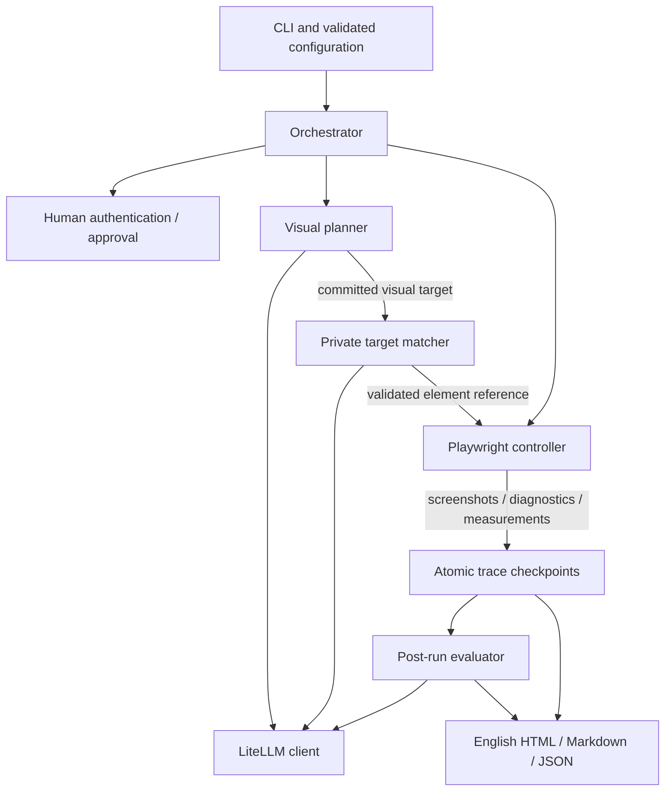

# VisualUX Agent: Design and Architecture

**Status:** Initial MVP implemented; real-model quality and actual SSO trials pending.

**Updated:** 2026-11-08

**Scope:** Local, task-driven evaluation of web usability.

**Reading guide:** [README](README.md) covers installation and use; this document explains the decisions, contracts, and validation boundaries. Public configuration examples live in [examples](examples/lab.toml).

## 1. Purpose and guiding principles

The tool investigates what a user can discover and understand from a visible interface. It runs tasks, records the path and difficulties, and reports evidence-supported UX concerns. Reaching a page is not enough for an information task: the result must answer the question with visible scope, units, and limitations.

Three decisions define the implementation:

- **Visual decisions, DOM-assisted execution.** The planner chooses a target from screenshots. The controller binds that choice and sends normal input events. Hidden labels must not correct a misunderstood icon or reveal an undiscovered feature.
- **Evidence before grading.** A model failure is not automatically a product defect. Findings separate observations, interpretation, attribution, and uncertainty; successful completion does not erase earlier friction.
- **A small local tool.** One orchestration process, readable configuration, local artifacts, and an existing model endpoint. No dashboard service, agent framework, database, or additional model gateway is required.

This is exploratory developer tooling, not a calibrated human-usability benchmark, comprehensive WCAG audit, or general-purpose functional test runner.

## 2. Product contract

### 2.1 Inputs and outputs

Inputs are a URL, a non-empty ordered task list, an image-capable model configuration, and optional auth state, domain knowledge, permissions, limits, and evaluation criteria. A single task is a one-item list. Accept repeated `--task` options or TOML `[[tasks]]`, never both; IDs must be unique filesystem-safe slugs. No correct click sequence is required.

Each attempted task produces a result, information answer when relevant, chronological trace, screenshots, action/timing metrics, UX assessment, and English Markdown/HTML reports. The run summary lists every task in order, including unstarted tasks and their reasons. Zero actions, zero supported concerns, and unsuccessful outcomes are valid results.

Optional `--knowledge` / `knowledge_file` supplies one UTF-8 Markdown file of concepts, business rules, field explanations, and non-secret test values. Validate readable, non-empty text and a 16 KiB limit before navigation; never silently truncate. Snapshot the exact text and hash once per run. The planner and evaluator receive it as reference data; the private matcher does not. It establishes neither current application state nor task success, grants no permissions, and must not carry credentials, hidden selectors, answer oracles, or correct click paths. Disclose supplied guidance and knowledge-conditioned results rather than claiming unaided discoverability.

### 2.2 Task types

Tasks may perform an operation, retrieve information, interpret information, or combine these. They share one agent implementation. An answer about all devices needs evidence covering that scope; a visible summary may suffice, while filters, pagination, truncated values, missing units, loading, or stale data may require exploration or an explicit limitation.

### 2.3 MVP boundaries

Use Python 3.11+, Playwright Chromium, sequential tasks, and vision-capable APIs. Generated report prose, labels, code identifiers, documentation, and default criteria are English; original tasks and quoted UI evidence retain their wording. Mock apps and static reports ship with the package. There is no numerical product-wide UX grade, demographic simulation, model training, or automatic application modification.

### 2.4 Task ordering and session behavior

- **`isolated` (default):** Each task starts at the supplied URL in a fresh browser context with the same initial auth/knowledge inputs and no prior agent memory. Ordinary task failure, blockage, or uncertainty does not stop later independent tasks.
- **`shared`:** Preserve the current context/page. Later tasks receive a fresh screenshot and bounded, evidence-linked prior visual outcomes. Continue only after completion and confirmation of any configured verification; otherwise mark later tasks `not_started: upstream_task_incomplete`.

Budgets and approval scope are per task. Shared state does not transfer authorization. Browser isolation does not undo backend writes or server-side preferences; equivalent starting data requires suitable accounts or fixture resets. Infrastructure errors and cancellation stop the run while preserving available artifacts. No parallel task scheduler, dependency graph, automatic restart, or task-output templating is included.

## 3. Architecture



The [orchestrator](src/visualux/orchestrator.py) owns lifecycle, budgets, permissions, and continuation. The [planner](src/visualux/agent.py) proposes one decision; the [browser controller](src/visualux/browser.py) owns binding, geometry, and execution. The [model boundary](src/visualux/model.py) validates responses and limits calls. The [evaluator](src/visualux/evaluate.py) reviews evidence; the [renderer](src/visualux/report.py) presents validated results and deterministic penalty arithmetic. These are modules, not independent services.

### 3.1 Responsibilities

The planner has no browser, filesystem, shell, network, or validator access. Matching cannot choose the next task action. The evaluator cannot turn model observations into verified facts; the renderer cannot invent findings, evidence, or confidence. Keep small helpers with callers rather than introducing provider base classes or tool/plugin registries.

### 3.2 Dependencies

Runtime dependencies are pinned Playwright, LiteLLM, and Pydantic. Standard-library facilities handle CLI (`argparse`), TOML (`tomllib`), hashing, timing, atomic JSON persistence, HTML escaping, and local demo serving. Playwright captures candidate regions directly; Pillow, Typer, OpenCV, a frontend build, and a separate gateway are unnecessary. `uv.lock` records reproducible dependency resolution.

## 4. Observation and evidence boundaries

### 4.1 Interaction-agent input

The planner receives the task, permissions, labeled knowledge, current/relevant screenshots, viewport, recent decisions/controller outcomes, compact task memory, and remaining budgets. Evaluation criteria and penalty rules do not guide its task path.

URLs are inspected internally for scope/auth routing. DOM/HTML/CSS, accessibility trees, hidden labels, selectors, browser storage, console/network contents, and backend responses are not application observations sent to the planner. It commits to a target on the original screenshot before any private candidate matching. Webpage instructions are untrusted task data.

### 4.2 Evidence provenance

| Source | What it establishes |
| --- | --- |
| Visual | Recorded pixels; model interpretation may still be wrong |
| Controller | Dispatch, timeout, blocked navigation, or download event; not visible application success |
| Geometry | Scoped border boxes, spacing, clipping, and sampled obstruction; not human performance |
| Verification | A separate configured outcome check; never a hint to planning/evaluation |
| Knowledge | Supplied reference context; not current application state |

The evaluator receives screenshots, trace context, and allowlisted geometry, not hidden DOM labels, auth state, downloaded contents, private expected answers, or verification inputs. The renderer adds verification separately.

## 5. Authentication and human assistance

Support unauthenticated browsing, an explicitly supplied saved state, and headed `--interactive` login. Interactive mode pauses before application capture/model calls; synthetic preflight may run first. The human signs in, returns to the app, and explicitly resumes in the same context. Capture, binding, and model decisions stop during handoff; record purpose/timing, not credentials or human keystrokes/screenshots.

Known login origins pause before capture. An unfamiliar login gate may first be recognized visually; detection is best effort. Mid-task expiry can resume after human auth; unattended execution returns `blocked: authentication_required`. Guidance or task UI operations beyond auth are marked assisted. Approval applies to a concrete proposed effect within the current task. Cancellation/timeout preserves partial results.

Save state only to an explicitly requested path, outside reports, using restrictive permissions. Loading it does not prove validity or portability across SSO systems. Credential entry and login-usability testing are outside scope. Human pauses are excluded from active execution time.

## 6. Execution lifecycle

Validate the merged configuration, task list, knowledge, and effective rubric before navigation. Initialize output and run synthetic visual/structured-response preflight once per distinct connection configuration. Then, for each task:

1. Apply bounded loading/render waits and record a screenshot with an evidence ID.
2. Read task-relevant content, assess the preceding visible outcome, preserve difficulties/recovery, and propose one action or supported result.
3. Validate the entire decision and references; checkpoint before execution. Finish may be zero-action. Human requests enter the suspended handoff path.
4. Check authorization, bind any committed target, measure available geometry, and recheck identity/obstruction. Do not execute ambiguous or stale bindings.
5. Record intent, dispatch once, wait within budget, capture the next observation, and repeat. The next decision assesses the preceding result; no extra model call is needed solely to populate outcome fields.
6. Finalize results/verification, evaluate the retained evidence, render reports, and apply isolated/shared continuation rules.

No apparent target is a discoverability candidate, not an automatic defect. Scroll, hover for tooltips, open visually relevant menus, or wait for visible loading as appropriate. Preserve every noticed difficulty and its final finding/non-UX/unresolved disposition. Repeated ineffective actions require a changed approach or termination; unchanged pixels alone do not imply no reading progress.

### 6.1 Action contract

[Decision schemas](src/visualux/schemas.py) use a validated discriminated union: `click`, `hover`, `scroll`, `type`, `keypress`, `wait`, `observe`, `request_human`, and `finish`. Unknown/oversized/malformed actions never execute. Browser actions declare effect and expected visible result; targets identify the current observation and a visual description, without coordinates or selectors. Typing requires a safe focused control and non-secret input; keys and scroll/wait amounts are bounded.

Screenshots, measurements, and transport coordinates use CSS pixels at a fixed viewport/device scale, without client resizing. The controller enumerates visible native/role/focus controls, then privately matches anonymous candidate clips to the already committed visual target. Matching requests omit task, knowledge, rubric, DOM text, and selectors. A unique match requires full candidate coverage; unresolved/unsupported binding blocks after bounded fresh-observation recovery.

Assume a normally settled page stays mostly stable during one cycle. Candidate clips are later captures, not crops of the same recorded frame; retain capture times/bounds. Navigation, target replacement, meaningful geometry change, or handoff invalidates binding. Recheck before dispatch. Use normal mouse/keyboard events, never forced clicks, `HTMLElement.click()`, synthetic DOM activation, overlay removal, or automatic offscreen scrolling. Coordinates and matching success are execution details, not human pointing measurements.

### 6.2 Waiting and browser scope

Initial navigation waits for `load` and a short render allowance. A later document navigation must wait for that new document, not reuse the old document's completed state. SPA updates use bounded settling followed by screenshot-based waits when loading remains visible. `load` does not establish asynchronous data/hydration readiness; `networkidle`, hidden readiness selectors, and screenshot equality are not universal success gates.

A load timeout produces `uncertain: navigation_load_timeout`, safely available partial evidence, and no actions on an incompletely loaded page. Record wait durations and incomplete readiness explicitly. Ordinary initial loading alone is not a UX defect.

Support one application page. Canvas-internal clicks, uploads (including direct file-input assignment), drag/drop, application multi-tab flows, native file pickers/dialogs, and unsupported bindings are tool limitations. Reading visible canvas content and receiving downloads remain supported. When a required interaction is unsupported, report blockage and coverage limits without a UX deduction for that limitation.

### 6.3 Budgets and termination

Defaults are engineering limits, not measured model-performance claims. [Limits](src/visualux/config.py) are configurable under `[limits]`:

| Field | Default |
| --- | --- |
| `max_steps` / `active_seconds` | 30 browser actions / 180 seconds |
| `interaction_requests` / `evaluation_requests` | 90 / 16 |
| `request_timeout_seconds` / `evaluation_seconds` | 45 / 180 |
| `navigation_timeout_ms` / `settle_ms` | 30,000 / 500 |
| `handoff_seconds` / `total_handoff_seconds` | 600 / 1,200 |
| `max_images` | 4 across the complete request; configurable 2–32 |
| `download_bytes` | 25 MiB per task |

Matching, retries, and preflight consume their applicable call/time budgets; setup usage is not double-counted. Evaluation has a separate budget. Preserve evidence on limits, errors, or cancellation. Use `uncertain` for insufficient evidence/limits, `blocked` for auth/permission/tool gates, and `failed` only for a supported unsuccessful task outcome. Do not replay interrupted actions.

## 7. Model integration

### 7.1 Provider support

Use LiteLLM as a client for a direct provider/local endpoint or the user's existing gateway. `litellm_proxy/<alias>` requires an explicit API base; forward the remaining alias unchanged, including slashes. Use an inference key from the configured environment variable, not an admin key or upstream-provider credentials. Never start/reconfigure the gateway, infer another endpoint, or silently fall back to another provider/model. Localhost does not prove that gateway routing stays local.

Preflight uses a synthetic image and validates a known visual fact plus response shape. Unknown alias metadata does not itself fail preflight; actual endpoint behavior is decisive. Support prompted JSON by default and explicitly selected `json`/`schema` modes, always with runtime Pydantic validation. Parse final response content, not provider reasoning fields. Allow bounded transient retries and one corrective malformed-response request; do not retry denied credentials/unknown aliases as transient failures or let nested SDK retries exceed budgets.

Record requested route/model, returned identity where available, prompt hashes, client call counts/durations, and available usage. Unknown backend identity/token usage stays unknown. Gateway-owned routing/retries are outside client observability. Do not persist raw provider bodies or credentials.

The first intended real trial is the owner's LiteLLM + Gemma 4 31B environment, currently **unverified**. Its actual alias, serving/quantization details, image forwarding, final JSON behavior, matching quality, context limits, and latency require live checks. Longer example budgets are allowances, not promises. The architecture is not tied to this model.

### 7.2 Context management

Maintain one logical task context, not an ever-growing image conversation. The initial planner receives current/preceding screenshots, bounded recent decisions, and a compact model-maintained memory with evidence references. Full images remain in local artifacts; an ID alone does not let a model see an omitted image. Automatic retrieval of arbitrary older screenshots into planning is not implemented. The matcher is stateless/task-free; evaluation processes the retained trace chronologically with overlapping batches.

Budget instructions, task, knowledge, schemas, history, images, output allowance, and margin together. Optional `context_tokens` uses the deployment's actual capacity; conservative UTF-8-byte/16-pixel-patch estimates are not exact provider accounting. Without a configured limit, capacity stays unknown. Remove optional old images/history or shrink matching/evaluation batches before rejection. Never silently omit mandatory context or resize required images; if the minimum request cannot fit, preserve artifacts and report an explicit error. A provider context rejection allows at most one smaller retry when optional context can be removed.

## 8. Data contracts and persistence

[Validated schemas](src/visualux/schemas.py) define model inputs/results; generated trace records carry a schema version. Keep task execution state, declared task outcome, independent verification, and evaluation coverage separate. A completion claim contradicted by verification is not verified success. Cross-task evidence references include task IDs.

Persist every decision, difficulty/update, binding attempt, measurement, handoff, model call summary, and dispatched step. One step is one dispatched browser action; observations, rejected actions, binding-only attempts, and handoffs have separate counts. Validate observation/step/measurement references and their associations rather than repairing missing evidence. Candidate views are transient; store source IDs and anonymous capture metadata, not DOM/selector dumps.

```text
reports/<unique-run-id>/
  index.html, summary.md, manifest.json
  rubric.md, knowledge.md                 # knowledge only when supplied
  tasks/<task-id>/
    report.html, report.md, trace.json
    screenshots/
    downloads/                           # when received
```

Use unique run directories, relative artifact paths, atomic JSON/report checkpoints, and an intent record before dispatch. An interruption during dispatch leaves an unknown outcome. Never overwrite a previous run. Stop browser actions if persistence fails. Generate download paths locally, enforce retention limits, and never execute downloaded files. Secret values, auth state, and raw provider request/response bodies do not belong in reports.

## 9. UX evaluation and reporting

### 9.1 Rubric

[Default criteria](src/visualux/rubrics/ux-evaluation.md) cover `information.comprehension`, `interaction.cost_recovery`, `interaction.target_access`, `expectation.mismatch`, `visual.task_salience`, and `semantics.feedback`.

Custom Markdown blocks start with `## <criterion-id>`. Matching IDs replace full guidance, new IDs append, and unmentioned defaults remain. `disabled_criteria` removes selected IDs after overrides. Reject invalid/duplicate IDs, empty blocks, unknown disabled IDs, missing files, and an empty effective set. Preview and execution use the same resolver; snapshot enabled text, hashes, resolution actions, and disabled IDs once per run.

Criteria can change relevance and assessment guidance, not evidence/schema/permission boundaries or fixed penalty eligibility. Findings reference enabled IDs. Disabled or unreviewed criteria are not presented as passing. Review interpretation as well as interaction: a correct all-green summary can be a strength; normal scrolling or useful tooltips are not automatically friction. Compare declared expectations with visible outcomes and consider alternative causes.

### 9.2 Health-grid example

A red warning can be easy to find while its detail control is too small or crowded. A successful assisted click does not eliminate a sourced geometry risk. Measure the control including padding: a 16-pixel glyph inside a 44-pixel button is not a 16-pixel target. A large wrapper/canvas container does not establish a subtarget's effective region. Unknown regions stay unknown; no human miss rate is inferred.

### 9.3 Attribution, certainty, and impact

Separate likely UX friction, application malfunction, agent error, controller limitation, and unresolved attribution. Keep facts separate from interpretation, with supported/tentative certainty. Supported concerns need a specific improvement or investigation suggestion. Preserve unsupported candidates in difficulty history with a disposition, not as confirmed findings.

`penalty-v1` maps eligible concerns to heuristic points:

| Severity | Points | Evidence of impact |
| --- | --- | --- |
| Low | 1 | Limited friction or a sourced local risk without demonstrated material impact |
| Medium | 3 | Observed material difficulty with recovery |
| High | 5 | Observed UX blockage without observed recovery |

Eligibility requires a supported UX concern, enabled criterion, and justified impact/severity. Tentative/non-UX findings, missing justification, malfunction alone, and strengths are unscored with reasons. Geometry alone cannot justify medium/high impact. Runtime checks require step evidence for material/blocking impact; semantic attribution remains a model judgment.

Deduplicate one control/state problem per task across repeated steps and criteria, retaining evidence, occurrence information, and recovery. Later success does not erase supported friction; disproved hypotheses receive no deduction. Final synthesis must account for prior finding IDs rather than silently dropping issues. The renderer computes points; strengths do not offset concerns.

Show a per-task total for complete evaluation, a partial subtotal when safely deduplicated, or no total when unavailable/failed/deduplication-incomplete. Unstarted tasks have no score. Zero points does not certify good usability or erase tentative concerns. Do not subtract from 100, normalize/grade, or add across tasks. Comparisons need matching task scope, starting data, knowledge, rubric, rule/model/configuration, viewport, budgets, and coverage, and remain exploratory because model judgments vary.

### 9.4 Metrics

Compute individual action counts from controller records, including waits; `type` counts once per call. Report observation-only turns and binding attempts/failures separately. Use UTC evidence timestamps and monotonic durations for wall time, active execution, model calls by phase, browser dispatch/navigation/settling, human pauses, and evaluation. Phase totals include their components; do not double-count them. Runtime/model latency is not human task time, and click counts are not UX scores. Backtracking is an evidence-linked interpretation, not a fact inferred solely from similar screenshots.

Geometry records report CSS-pixel border boxes, local neighbor spacing/coverage, clipping, and five pointer-hit samples with method/time/limitations. They are read-only measurements tied to observation/layout state, not reconstructed activation regions. No handler inspection or exploratory click grid is allowed. Exact image contrast ratios and general effective-hit-region reconstruction are deferred.

### 9.5 Optional verification

A configured download check verifies receipt/completion and declared filename/extension only, not actual format, contents, freshness, or semantic correctness. Keep this result separate from visual task completion. Downloaded contents and harness ground truth never guide the planner/matcher/evaluator. General executable validators are deferred.

### 9.6 Report contract

Task reports include configuration/provenance, knowledge/guidance, outcome/answer/scope, assistance/verification, chronological decisions/outcomes, difficulty dispositions, concerns/strengths, penalty details, action/timing metrics, measurement limits, coverage, and linked screenshots/trace. Show expected and actual outcomes for mismatches; unavailable evaluation is not a clean bill of health. Supported suggestions address the evidenced issue. The run summary includes every task and links available reports.

Render English HTML and Markdown from the same validated data without extra model calls. HTML uses local relative artifacts, embedded CSS, semantic headings, native disclosure controls, and escaped untrusted text/attributes. It works from local files without JavaScript, external assets, or a report server. Build links from recorder-owned paths, not model markup or website-supplied filenames. Preserve original quoted evidence and keep raw technical records inspectable.

## 10. CLI and configuration

The implemented commands are `run`, `auth`, `rubric`, and `demo`; see [README](README.md) and [copyable configurations](examples/lab.toml) for usage. Explicit CLI options override TOML, then defaults apply. TOML paths are relative to that file; CLI paths are relative to the working directory. No implicit model is selected. An evaluator override is an independent connection configuration and must not accidentally inherit credentials for another endpoint; explicit name-only overrides retain the effective connection being overridden.

Model options include `name`, `api_base`, `api_key_env`, `response_mode`, `max_output_tokens` (4096 default), and optional `context_tokens`. [Configuration models](src/visualux/config.py) define accepted fields and validation. Secrets come from environment variables, never saved config values. `rubric` and `demo` require no inference credentials.

`demo` serves only bundled public assets on loopback, default port 8765 with a port override. It never starts inference or exposes repository files, private manifests, reports, or config secrets. `auth` opens a browser without model calls and saves state only after explicit completion. Exit codes are 0 for completed execution/reporting (including ordinary unsuccessful outcomes), 1 for runtime/evaluation failure, 2 for invalid configuration, and 130 for cancellation; available partial artifacts remain.

## 11. Permissions and data handling

Default grants are inspection, navigation, filtering/search, and downloads in authorized test environments. Writes, destructive effects, messages, purchases, and sensitive settings require explicit task-scoped authorization. Interactive approval shows a concrete proposal; unattended unauthorized actions block. Approval does not extend to unrelated tasks/effects. Effect classification can be wrong, so this is not a universal safety barrier for arbitrary production apps.

Application origins scope navigation; login origins are for human auth, not autonomous task actions. These checks are not a complete network sandbox. Screenshots, tasks, and knowledge go to the configured endpoint/gateway and its selected backends/logging. A local address does not establish local inference. Use suitable infrastructure or sanitized data when privacy matters. No automatic PII redaction is promised, and exact screenshots/knowledge remain in local artifacts. Auth state/credentials stay outside those artifacts; do not log secret-bearing queries or raw provider bodies.

## 12. Development validation set

### 12.1 What the set contains

Ship three small apps, each with clear/confusing variants and equivalent core data/operations:

| App | Tasks and UX probes |
| --- | --- |
| Lab Monitor | Laboratory → searchable/paginated device list → warning/calibration detail; units, salience, small targets |
| Report Center | Catalogue → filtered records → export configuration/download; ambiguous labels, scope preservation, weak feedback |
| Device Setup | Inventory → registration/validation → persisted record; field guidance, late errors, input loss |

Each representative task must require two meaningful document navigations and multiple interactions from its entry URL. Initial loading and in-page filters do not count as document navigations. Browser tests verify both variants' complete paths, actual downloads, recovery, and saved records after refresh; the real-model matrix checks completed tasks against private minimum navigation/action counts. Trace metrics record action-associated document navigations separately from browser steps.

The apps are browseable without a model and reused by tests. Use ordinary DOM controls, deterministic synthetic client data, reset instructions, English UI, and no external assets/build. The gallery links a bundled setup guide covering installation, two-terminal execution, model connection, manual walkthroughs, and reset/troubleshooting. The gallery/guide may explain variants; evaluated app pages carry no issue/answer annotations. Human walkthroughs are not model inputs. Ship examples/knowledge with placeholder connection settings. Private checks and special fault states remain outside served assets and all model contexts. Reports must reflect actual runs, not scripted demo findings.

Tests cover schema/config/rubric/knowledge validation, evidence associations, malformed actions, geometry/padding/obstruction/staleness, auth capture suspension, limits/partial loads, session continuation, transport aliases/keys/retries, download checks, context batches, cancellation persistence, deduplication, and HTML escaping/local links. Include private offscreen/paginated/loading/freshness and unsupported-target cases as validation expands. Package checks verify installed demo/rubric/example assets outside the source checkout.

### 12.2 How results are assessed

Use deterministic fixture facts/contracts for answer and execution checks, not an LLM judge alone. Human review assesses whether evidence supports UX impact, whether alternative causes were considered, and which concerns were missed or falsely reported. Compare answer accuracy, unsupported claims, UX findings, and execution errors separately. Variant pairs need not receive predetermined scores.

The scripted endpoint validates orchestration, not model vision/UX quality. The opt-in [live matrix](tests/test_live.py) uses private [case manifests](tests/cases/demos.json), retains artifacts, and must be supplemented by review and repeated runs to expose variability. Small fixtures do not establish equivalence to human usability testing.

## 13. Implementation milestones and acceptance

The initial implementation includes browser/session handling, ordered visual task loops, criteria/evaluation, evidence persistence, three paired demos, and static English reports. Automated browser/controlled-endpoint checks cover engineering contracts; they are not proof that the product reliably finds real UX problems.

Before claiming tested real-model support, run all demo categories and both variants through the public CLI/configuration path. Include operation/information tasks, knowledge present/absent, a zero-action answer, and a download check; inspect results, evidence, difficulty attribution, supported/unscored findings, penalty deduplication, metrics, coverage, and report links. List actual model/serving configurations and missed issues honestly. Real SSO/manual headed login needs its own smoke test.

**Current validation boundary:** the Gemma 4 31B gateway trial, actual SSO, provider-specific token calibration, model accuracy/latency, and human-usability calibration remain unverified. These do not block committing an explicitly labeled initial MVP, but they block claims of validated model quality or completed live acceptance.

## 14. Deferred work and remaining uncertainty

Unsupported/deferred work includes canvas subtarget execution, uploads, drag/drop, multi-tab workflows, general external validators, exact contrast/effective-hit-region reconstruction, automatic PII masking, subscription/agent-CLI adapters, repeated-run comparison tooling, CI regression scoring, and native desktop/mobile backends. Do not score tool limitations as product defects.

The initial binder works on main-document native/role/focus controls and at most 80 visible candidates; iframe controls, arbitrary click handlers, or larger sets may block. Mostly stable settled pages are assumed; changes between planning, matching, and dispatch can escape basic identity/geometry checks. Dense tables, ambiguous icons, stale data, image matching, memory summaries, and attribution remain model-dependent. Measure these limitations on real apps before adding more architecture.
